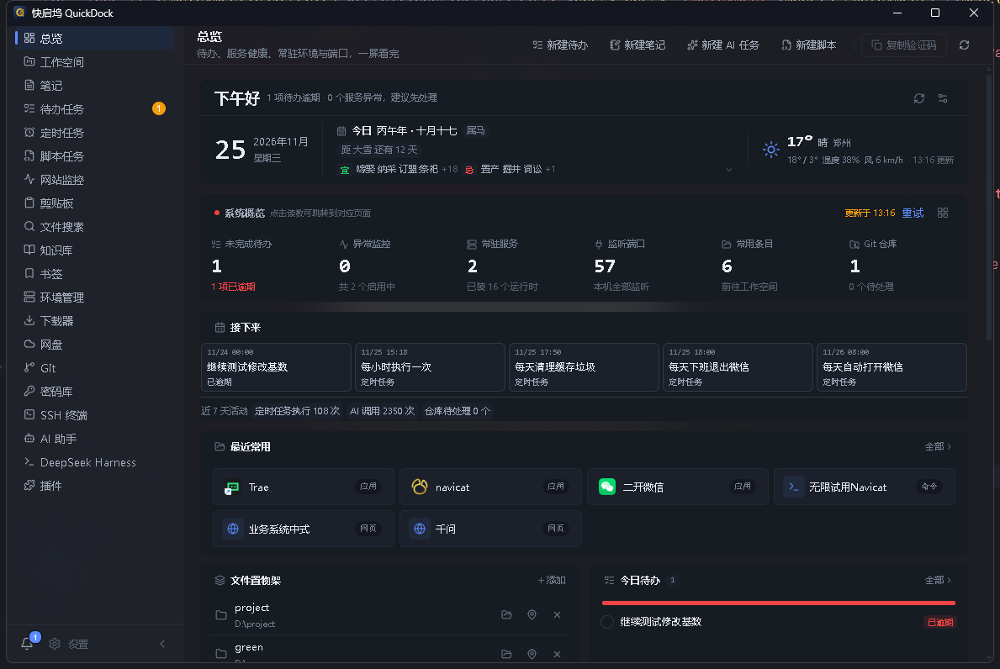

# 快启坞 QuickDock

**Windows 桌面效率工具箱 · 本地开发环境管理器 · AI Agent 与 MCP 中枢**

`Resource tree` · `Global hotkeys` · `Runtimes` · `AI agent` · `Plugin ecosystem`


[中文](README.md) · **English**

[Website](https://parieses.github.io/quickdock/) · [Guide](https://parieses.github.io/quickdock/guide.html) · [Issues](https://github.com/parieses/quickdock/issues) · [Plugin marketplace](https://github.com/parieses/quickdock-plugins)

<p align="center">
  
</p>

---

## Contents

- [Why QuickDock](#why-quickdock) · [What is this](#what-is-this)
- [Features at a glance](#features-at-a-glance) · [Installation](#installation)
- [Feature details](#feature-details)
- [Architecture](#architecture) · [Tech stack](#tech-stack) · [Development](#development)
- [UI design](#ui-design) · [Plugins](#plugins) · [License](#license) · [Third-party components](#third-party-components)

---

## Why QuickDock

A developer's desktop usually has project folders, frequently used commands, API docs, todos, monitoring dashboards and several versions of runtimes open at once. Each is light on its own, but you switch between them dozens of times a day.

QuickDock puts them in one window, organized around a resource tree and global hotkeys, with screenshots, window tiling, local HTTPS sites, an AI assistant and a plugin system on the side.

- **Resource tree** — workspace → scene → collection → item, with drag sorting, FTS5 full-text search and variable expansion
- **Hotkeys** — `Ctrl+Space` main window, `Ctrl+K` command palette, `` Ctrl+` `` clipboard, `F1` screenshot; all rebindable
- **Runtimes** — languages, databases, middleware, network services and AI tools: install, switch versions, start/stop and read logs in-app
- **AI** — a local agent that can edit files and run commands (per-step approval and rollback), multi-model chat, SSH sidebar, clipboard/note quick asks, plus an MCP server
- **Scripts** — a local script station for JS / Python / Shell / Go / PHP with per-script dependencies, logs and AI-assisted editing
- **Netdrive** — a self-hosted browser for aggregated gateways; online preview/play and batch downloads go to the downloader
- **Machine migration** — export a full zip, or select only the features you need by navigation menu; import and merge on another PC, with the credential vault carried in a password-encrypted package
- **Vault** — one place for SSH / website / API credentials, AES-256-GCM with a DPAPI-wrapped key, optional browser extension autofill; no cloud, no telemetry
- **Install** — single-file, per-user installation, no admin rights, in-place updates
- **Lock** — `Ctrl+Alt+L` locks the UI while background jobs keep running; typo auto-unlock and a one-time recovery code

---

## What is this

| | |
|---|---|
| **Category** | Windows desktop launcher · local development environment manager · productivity toolbox |
| **Platform** | Windows 10 / 11 desktop app (Go + Wails v3 + Vue 3), single file, per-user install, in-place update |
| **Data** | Local SQLite + FTS5; optional WebDAV sync and machine zip migration; no account required |
| **AI** | Bring your own key for OpenAI / DeepSeek / Kimi / Qwen / Ollama / custom compatible APIs; a local agent that edits files and runs commands with per-step approval/rollback; MCP server included |
| **Runtimes** | Node.js, Go, PHP, Python, Bun, JDK, Erlang, MySQL, MariaDB, PostgreSQL, MongoDB, Redis, Memcached, RabbitMQ, MinIO, Nginx, Apache, Caddy, Traefik, Git, GitHub CLI, Composer, FFmpeg, aria2 and more — install / switch / start-stop / logs all in-app |
| **Extensions** | Plugin marketplace; pure-frontend, embedded JS sandbox and native subprocess runtimes with declarative Host API permissions |
| **License** | MIT, free, no ads, no paywall |

In one line: **one window for desktop shortcuts, global hotkeys, runtime installation and control, an AI agent and a stack of small tools** — no desktop full of icons, no separate manager per runtime.

Find it by these terms:

- **Productivity**: Windows launcher, desktop launcher, app launcher, command palette, clipboard manager (text / image / files / cleaning rules), window manager and screen tiling, screenshot annotation and desktop sticky notes, screen lock
- **Development**: local dev environment manager, runtime and SDK version manager with coexistence and per-project activation, local dev sites and HTTPS certs (mkcert; QuickDock itself never listens on a port), PATH visualizer, project directory health check, SSH / SFTP terminal, Git panel, aria2 download manager, OpenList / WebDAV netdrive
- **Tasks & monitoring**: todo list / kanban / four-quadrants / Pomodoro, cron and interval scheduler (once / every N / daily / weekly / monthly / cron), local script automation, uptime and port monitor, notification center, IMAP verification-code mailbox
- **Data & security**: local knowledge base (FTS5 trigram + vector recall fusion), quick notes with wiki links, local password manager (AES-256-GCM + DPAPI, browser extension autofill), migration and backup
- **AI**: local AI assistant, AI coding agent (edit files, run commands, stepwise rollback), run traces and usage stats, MCP server at `http://127.0.0.1:9230/mcp`, plugin ecosystem

---

## Features at a glance

<details open>
<summary><b>Core productivity</b></summary>

| Feature | Default hotkey | Notes |
|---------|----------------|-------|
| Workspace / scene / collection / item | — | Four-level resource tree, 6 item types, drag sorting, FTS5 search. There is a single default workspace; data from older workspaces is merged in on upgrade. Workspaces / scenes / collections / items can each be marked "exclude from Ctrl+K search", hiding them across the resource tree, command palette, AI and MCP (with a settings toggle to reveal hidden entries). Scenes and collections can be named into collapsible groups; batch delete / move across collections, color flags and custom icons |
| Command palette | `Ctrl+K` | Searches workspaces, scenes, collections, items, notes, todos, apps, files, plugin commands and system commands; backend resolves items / notes / todos in one pass; jump straight to any page anchored on a result. Type "new note / new todo" to create inline. URLs are saved as items; file results preview inline (images, code, Markdown, PDF, audio/video, archives, folders) |
| Clipboard history | `` Ctrl+` `` | Text, images and files; pinning, backend search, expiry cleanup, bulk clear, reveal in Explorer, save images, "paste as plain text / Markdown / JSON", multi-item paste queue, ignore by source window, pause capture |
| Clipboard rules | — | Clean copied content by condition: trim blanks, drop empty/duplicate lines, sort, JSON format, strip ANSI, URL decode, case conversion; priority ordering and dry-run with a simulated source window |
| Quick notes | `Ctrl+Alt+N` | Tree-shaped Markdown notes, autosave, hide on blur; `[[wiki]]` links with backlinks, cross-links between notes / todos / items, graph view and block outline; left rail groups by recently edited; palette jumps to any note |
| Bookmarks | — | Read local Chrome / Edge / Brave / Chromium / Vivaldi / Firefox bookmarks directly (Chromium `Bookmarks` JSON, Firefox copies `places.sqlite`), or import an exported HTML file. Folders become collections, multi-level paths become group names, bookmarks become "web page" items; normalized URL dedupe makes re-import idempotent. Then fill icons, check dead links (404 / blocked / moved / content changed), merge duplicates and see curation insights (never opened, stale > 30 days, added this week) |
| Hotkey cheat sheet | — | Type `cheatsheet` in the palette, or use the button on Settings → Hotkeys. Shows currently effective bindings |
| Recent activity | — | Settings → History: usage heat on the left, operation timeline on the right, with the recycle bin on the same page |
| Log viewer | — | Settings → Logs: per-day app logs and crash records, level filters, cleanup, and one-click "ask AI about this log" |
| Live log tail | — | Type `logtail` in the palette to run `tail -f` on any local file, pause and highlight keywords; the top status bar shows following / paused and lines read |
| Notification center | — | Bell at the sidebar bottom: monitor state, scheduler results, mail codes and AI completion, unread badges; filter and search by type, jump to the source; webhook bots can send a test message |
| Dashboard | — | Date bar (lunar calendar / solar terms / today's taboos / city weather, can be disabled) and six overview readings, followed by eleven cards: up next, most used, file shelf, today's todos, scripts, mail codes, occupied ports, resident services, Git repos, site health, AI usage. Cards can be hidden / reordered; stale readings turn yellow after 5 min and red after 30 min; failures are marked in place instead of showing old values |
| File shelf | — | Drag files or folders onto the dashboard card, or use "Add"; double-click to open, reveal in Explorer or remove. Stores paths only, max 200 |
| Mail codes | — | Multiple IMAP mailboxes (inbox read-only); new codes merge by account on the dashboard, click to copy and push a notification; opens the raw mail (HTML rendered as cards); security alerts land there too. Never marks read, sends or deletes mail |
| Weather & almanac | — | Open-Meteo / HeFeng / CaiYun / wttr.in with pinning and automatic fallback; keeps the last successful result so the card never blanks. Day/night derived from local sunrise/sunset. Offline lunar calendar and solar terms; taboos computed locally from the traditional Jianchu system, labeled as folklore reference. City search supports Chinese / English names and provinces |
| Window material | — | Win11 Mica / Acrylic / Mica Alt across the main window, four floating windows, SSH and plugin windows; Win10 or "Off" falls back to solid color, pixel-identical to before |
| Startup lock | `Ctrl+Alt+L` | Lock the main and all standalone windows with one unlock box; floating hotkeys wake the main window with a hint. Monitoring, schedulers, IMAP, weather, clipboard capture, SSH sessions and MCP keep running. Auto-unlock after enough correct digits; one-time recovery code resets a forgotten password. Optional "lock after N minutes idle" times the last keyboard / mouse input, so watching a video still counts as idle |

</details>

<details open>
<summary><b>Tasks & monitoring</b></summary>

| Feature | Notes |
|---------|-------|
| Todos | List / kanban / four-quadrant views, subtasks, tags, recurrence, due reminders; subtasks can have their own due date, in-page search, calendar drag to reschedule; recurring tasks leave a completion trace instead of resetting in place, "this time only" or "all", snooze; Pomodoro duration configurable with history, system notification and optional bot push |
| Scheduled tasks | 7 action types × 6 schedules (once / interval / daily / weekly / monthly / cron), pinyin search and batch enable/disable, next-run countdown, cross-task history stats and CSV export, manual run. Actions can run an AI prompt or an existing script; AI results append to the same conversation by execution time; tasks can expire and auto-disable, missed slots are caught up within a window; manual runs are async with visible progress and cancellation; notifications are "every time / failures only / none", with a permanent archive in the notification center |
| Scripts | Browser-style local script manager: JS / Python / Shell / Go / PHP run directly; code, dependency files and variables editable in-page; auto-install requirements / npm / go mod / composer, interpreter resolution from script → env manager → PATH; manual / timer / file-change / local HTTP triggers, concurrency gate, timeout, logs and run history; scripts export as zip for machine migration |
| Website monitoring | Six probe types (HTTP / TCP / DNS / Ping / local process / custom command), status code and latency, SSL expiry warnings, keyword and regex matching, trend chart, uptime doughnut, 24h p95 / p99 percentiles; read-only status page with static HTML export. State changes push notifications via 6 built-in bots plus Bark / Discord / Slack / Ntfy / Gotify / custom webhooks. Search, batch start/stop, drag sorting, global recycle bin (Settings → History, 30-day cleanup), maintenance and silence windows |

</details>

<details open>
<summary><b>AI & development</b></summary>

| Feature | Notes |
|---------|-------|
| AI assistant | OpenAI / DeepSeek / Kimi / Qwen / Ollama / Azure / custom compatible APIs; SSE streaming, thinking and tool calls collapsed by default, multiple sessions with rename / search / star / summarize / Markdown export, segmented history and continuation; keys encrypted with DPAPI, plaintext viewable and copyable while editing |
| Prompt library | 13 built-in prompts, editable under Settings → AI Assistant; the `+` panel expands by category, variables like `{{date}}` are substituted on insert, and current conversation output or workspace files can be attached as reference chips |
| AI agent | Edits files and runs commands: per-step approval (remember by command family; chained commands do not false-match), pre-write snapshots and stepwise rollback, line-level diff, project rule files and hooks, `@` file references and history, external MCP servers; three permission tiers (read-only / default / full access) — read-only does not even mount write tools, full access requires risk confirmation; selected skills expose their `SKILL.md` without extra confirmation and are marked on the message bubble; long commands go to background with a log panel and terminate button; you can interject while an answer streams; every answer ends with "AI-generated content — verify important information" |
| Run traces | The "Traces" drawer splits an answer into a run tree: which tool each step ran, its duration, lines changed and what subagents were assigned, layered by depth. Replayable after completion; 1s refresh while running, auto-stop at terminal state. "Subtasks" summarizes delegated agents and their steps. Context compression is recorded in both traces and the answer, with before/after sizes |
| Context usage | A toolbar dialog shows tokens used, distance to the model window and budget, and compression count; windows are recognized by model name, with manual compression available |
| Answer rendering | LaTeX, Mermaid, syntax highlighting, sortable tables with CSV export, sandboxed preview of `html` code blocks; figures and formulas copy as images; files written by the answer appear as "Artifacts", with preview and an inline CodeMirror 6 editor for config files |
| AI usage stats | Estimated cost, question count and tokens over 7 / 30 / all days, split by model and entry point, with cache hits listed separately |
| Image understanding | Paste, pick or drop images into a conversation; input mode configured per model capability |
| AI in terminal | SSH sidebar asks with the current screen attached, selected output as context; commands can be filled in or executed |
| AI on clipboard | "Ask AI" on a clipboard entry opens an inline panel with translate, summarize, format and free-form prompts |
| AI on notes | Embedded panel in the note floating window: summarize, polish, continue, translate |
| DeepSeek Harness | Full agent coding entry with auto-installed portable Node, native window on port 3080; WebView2 version checked before launch and the process auto-restarts on crash |
| MCP service | `http://127.0.0.1:9230/mcp`, tools in read-only / low-risk write / high-risk tiers (read-only + low-risk write open by default); downloader tools (list tasks and progress, pause / resume / delete), SSH tools (list hosts, SFTP read, restricted exec — no host authorized by default and per-host `mcpAllowed` opt-in; file-write and upload tools are deliberately absent), script tools (list scripts / source / logs, AI creates scripts and code/dependency files, running still requires per-script opt-in); high-risk process kill and raw system commands are never registered — they do not exist as tools |
| Git panel | SourceTree-like repository view: branches / tags / remotes / submodules, stash, file history and blame, amend, cherry-pick, revert, branch comparison and side-by-side diff, one-click SSH key setup for GitHub / GitLab, multi-select batch actions and archive export. The commit graph lays out lanes from each commit's parents (no `git log --graph` ASCII, so branch lines never break), history switches between "current branch" and "all", and the repo / worktree / detail columns plus the staged and unstaged panes are all draggable |
| Environment manager | Install, switch, start/stop, configure and read logs for runtimes, all inside the user directory; upstream version lists cached in memory and on disk, refreshed in background; each runtime has a "?" info card (group, what this page does, hints, live status and official links), including special items like DSH; read-only project health check compares version declarations to installed/active versions and snapshots dependency manifests; PATH panel lists every runtime's bin directory with per-version enable/disable instead of wholesale overwrite |
| Downloader | aria2 engine: links, batches, magnet, torrent, Metalink; status pages and seven-tab details, multi-select, speed chart, pre-download disk check, retry, completion notifications, per-task directory and per-file folder; disk guard and engine self-heal on full disk; BT and remote engines; progress queryable through MCP |
| Netdrive | OpenList as aggregation gateway (Baidu / Quark → WebDAV + web UI) with a self-built browser instead of an embedded vendor page: directory browsing, online preview for images / video / audio / PDF / text (local proxy bound to loopback with a random token, Range passed through for video seeking), create / rename / delete / deep search / sort, batch downloads handed to the downloader with explicit file names. Gateway managed by the environment manager, password synced with its database on startup. You can also point it at an OpenList you already run yourself (Docker or another machine) — no second copy, and no fight over port 5244 |
| Knowledge base | Import local docs (Word / Excel / PDF / Markdown / plain text) for Q&A and retrieval: Chinese uses FTS5 trigram, vector recall runs in parallel when an embedding model is configured, and the two are fused with RRF. Results include source snippets that link back to the original; documents are grouped into libraries and imported only once; AI answers, note bodies and clipboard entries can be added with one click |

</details>

<details open>
<summary><b>Toolbox</b></summary>

| Feature | Default hotkey | Notes |
|---------|----------------|-------|
| Screenshot | `F1` | Native layered overlay: region select, annotate, color picker, numbered markers, copy, save and sticky notes (transform, click-through, zoom) |
| Window management | `Ctrl+Alt+W` | 15 snap hotkeys and a nine-grid tiling overlay, leaving `Win+Arrow` alone |
| Local dev sites | — | Three-step wizard "directory → domain → certificate"; bind a custom domain and auto-issue an HTTPS certificate (mkcert). QuickDock itself never listens on a port |
| SSH terminal | `Ctrl+Alt+S` | Multi-tab terminal and SFTP (multi-select, atomic replace on write with remote hash check before overwrite), fingerprint trust, multi-host batch exec and broadcast input (send one by one, confirm each), CSV export of results and retry only failed hosts, connectivity test, one-shot commands with risk confirmation. Clickable URLs, keyword search/jump, draggable tabs; ProxyCommand, login commands, one-shot sudo and keyboard-interactive multi-round auth; OSC 7 syncs the local directory. Hosts support tags / colors / icons and one-way import of OpenSSH config (read-only, never writes back). Screen shares are sanitized before reaching a model: PEM blocks, key assignments, CLI arguments, credentials in URLs, Bearer and vendor tokens are stripped |
| Vault | — | Web / SSH / database / Git / WebDAV / API keys in one place, AES-256-GCM with DPAPI-wrapped key, local only and excluded from sync; Chrome / Edge extension for autofill and save prompts; SSH asks inline when no password is stored |
| File search | — | Everything-backed page: four-state probe (missing / stopped / indexing / ready) with install guidance, on-page syntax cheat sheet, one-click presets (changed today / code files / large files / archives), recent searches, sort and limit, multi-select copy paths, inline file preview |
| WebDAV sync & snapshots | — | Full JSON backup/restore, multiple versions, any WebDAV server |
| Data directory move | — | Settings → Storage & Sync changes the storage location and migrates the whole directory; takes effect after restart |
| Machine migration | — | On PC A export a zip (DB consistency snapshot + manifest): full machine or **select features by navigation menu** so only their tables and data-directory files are packed. On PC B import from Settings: rows are merged, not replaced — local records win and only missing ones are added, no directory switch, no restart. The vault is sealed with a user password for cross-machine restore. The package is inspected read-only before import (including its scope) and progress is reported throughout |
| UI zoom | — | Main window and all standalone windows scale uniformly by 1.15× |

</details>

<details open>
<summary><b>Plugins</b></summary>

- Three runtimes: **none** (pure frontend), **goja** (embedded JS sandbox), **native** (separate subprocess), communicating over JSON-RPC 2.0
- 34 Host APIs in 14 capability groups, with declarative permission checks (filesystem scope, network allowlist, clipboard, processes, etc.)
- Host AI exposed to plugins: `host.ai.ask` reuses the user's configured profile, credentials never leave the backend; pass a `streamId` for streaming
- Official plugins install and upgrade from the online marketplace; manifests and development docs live in the [quickdock-plugins](https://github.com/parieses/quickdock-plugins) repository

</details>

---

## Installation

### Requirements

- Windows 10 1809+ or Windows 11
- WebView2 Runtime (bundled with Windows; 119+ recommended — older versions make the DeepSeek Harness window repeatedly show `connection lost`)
- About 50 MB on disk; runtimes are downloaded on demand

### Steps

1. Download `quickdock-amd64-installer.exe` from [Releases](https://github.com/parieses/quickdock/releases)
2. Run it; default install location is `%LOCALAPPDATA%\Programs\快启坞`, no admin rights needed
3. Launch `QuickDock.exe`; a tray icon means startup finished

Read the [guide](https://parieses.github.io/quickdock/guide.html) first if this is your first run; the same link is in Settings → About and the workspace empty state.

Keep the default install path. In-place updates need write access; moving to `C:\Program Files\...` means UAC on every update and automatic updates will fail, leaving only a manual overwrite.

A portable `quickdock-amd64.exe` is also available — put it in any user-writable directory; in-place updates work there too.

### Hotkeys

| Feature | Default |
|---------|---------|
| Toggle main window | `Ctrl+Space` |
| Command palette | `Ctrl+K` |
| Clipboard history | `` Ctrl+` `` |
| Quick note | `Ctrl+Alt+N` |
| Region screenshot | `F1`, falls back to `Ctrl+Shift+A` |
| Window tiling overlay | `Ctrl+Alt+W` |
| SSH terminal | `Ctrl+Alt+S` |
| Lock UI | `Ctrl+Alt+L` |

All of these can be changed under Settings → Hotkeys and Settings → Window Management, with live re-registration. Type `cheatsheet` in the palette to see the effective bindings.

---

## Feature details

<details>
<summary><b>Workspace & resources</b></summary>

- **Workspace**: a single default workspace — no creating or switching workspaces; on upgrade, data from older workspaces is merged into the default one (same-named scenes merge, no items lost)
- **Scene**: a view group under a workspace, with tags, icons and colors
- **Group**: scenes and collections can have a group name shown as a collapsible section; unnamed groups sink to the bottom. Scene exports keep groups intact across machines
- **Collection**: a concrete resource folder; default tool, open strategy and plugin binding can be set per collection
- **Item**: 6 types (web page, directory, app, command, tool, plugin); variables like `%WORKDIR%` expand on open
- **Search**: FTS5 over items plus pinyin initials and substring matching in the command palette; workspaces, scenes, collections and items can individually opt out of `Ctrl+K` search. Hidden entries are filtered from the resource tree, command palette, AI tools and MCP results alike (Settings → Search scope), with a "show hidden items" escape hatch for editing
- **Bookmarks**: imported bookmarks land in the default workspace under a scene of type "Bookmark" and collections of type "Web page collection"; the folder path is kept as the collection group name

</details>

<details>
<summary><b>Command palette & search</b></summary>

- `Ctrl+K` opens a frameless palette with grouped results and keyboard-only navigation
- Backend resolves items / notes / todos in one pass; the remaining groups come from their own services
- File results preview inline; URL results can be saved as items without leaving the palette
- Typing a page name jumps straight to it (workspace, notes, todos, schedules, monitors, clipboard, runtimes, AI, plugins, scripts, bookmarks, downloads, netdrive, credentials); Git repos and SSH hosts get their own groups, and picking a host wakes the SSH window already connected to it
- New-note / new-todo actions create the entry inline and open it anchored
- Search exclusions and the `no_search` flag are honored by the palette, resource tree, AI tools and MCP tools alike

</details>

<details>
<summary><b>Dashboard & notifications</b></summary>

- The dashboard aggregates nine IPC sources and keeps them alive with KeepAlive, refreshing silently on activation
- Cards are reorderable and hideable; each row links to its page anchored on the underlying record
- The notification center archives status changes, scheduled results, mail codes and AI completion with per-type filters and search

</details>

<details>
<summary><b>AI, scripts & scheduling</b></summary>

- AI spaces separate normal chat from scheduled-task and SSH conversations; messages, tool rounds, reasoning and attachments are persisted
- Scheduled tasks share the MCP tool surface with the AI assistant; tasks without tools get a corrective retry
- Scripts store their body under `dataDir/scripts/<id>/` (disk is the source of truth); `script_envs` hold variables, secret ones marked
- Manual scheduler runs are asynchronous, with progress events and cancellation from the task list

</details>

<details>
<summary><b>Sites, certificates & local servers</b></summary>

- The site wizard binds a custom domain to a project directory and issues a local HTTPS certificate via mkcert
- QuickDock generates nginx / Caddy configuration but never rewrites their main config files and never listens on port 80 or 443 itself; 443 is the site port and 80 issues a 301 redirect

</details>

<details>
<summary><b>Data, backup & migration</b></summary>

- **Snapshots**: JSON snapshots stored in the DB, with daily / weekly automatic retention under Settings → Snapshots
- **WebDAV sync**: full JSON backup to any WebDAV server, with password-protected configuration
- **Vault package**: `.qdv` portable credential package sealed with a user password (the DB copy is DPAPI-bound and cannot be moved as-is)
- **Machine migration zip**: a `VACUUM INTO` database snapshot, a `quickdock-transfer.json` manifest and the data-directory files; select full machine or individual navigation features at export time, then merge on the target machine without switching directories or restarting
- **Data directory move**: repack the whole directory into a new location; effective after restart

</details>

---

## Architecture

```
main.go  → Wails services (binding layer)  → internal engines
                                             env / dsh / plugin / db / platform /
                                             sync / webdav / dl / logger / sysutil /
                                             mcp / sites / winmgr / screenshot / migration
```

- **Facade layering**: domain capabilities live in 33 subpackages; the host core stays in `AppService`. `wails3 generate bindings` generates 37 services / 842 binding methods (counted from exported binding functions; see the project tree below)
- **Platform differences** live only in `_windows` / `_unix` files; business code never imports `w32` / `windows` / `syscall` directly
- **Child processes** go through `internal/sysutil`; hidden consoles use `InitHiddenConsole()` and detached restart uses `sysutil.Command(...).StartDetached()`
- **Plugins** never pop system dialogs through the backend: use `host.dialog.*` / `qdPickFile` / `qdPickFolder`
- **Deletion** goes through `platform.MoveToTrash`, never `os.Remove`

---

## Tech stack

| Layer | Choice |
|-------|--------|
| Desktop shell | Wails v3 (Go + WebView2) |
| Backend | Go, modernc.org/sqlite, goja, dsh |
| Frontend | Vue 3 + Pinia + TypeScript, Vite |
| Search | SQLite FTS5 (unicode61 for items, trigram for notes and knowledge chunks) |
| AI | SSE streaming, MCP server, pluggable OpenAI-compatible profiles |
| Packaging | Single-file installer and portable exe, Windows-only releases |

---

## Development

### Prerequisites

- Go (see `go.mod` for the exact version) and Node.js with npm
- The Wails v3 CLI must match the Wails module version in `go.mod`

```bash
# Install the Wails CLI at the exact version from go.mod
go install github.com/wailsapp/wails/v3/cmd/wails3@<version>

# Frontend dependencies
cd frontend && npm install

# Regenerate bindings after changing Go services
wails3 generate bindings -clean=true -ts -i
```

### Common commands

```bash
wails3 dev                       # development build with hot reload
wails3 build                     # production build (includes vue-tsc)
go test ./internal/... ./services/...
npm --prefix frontend run check:i18n
npm --prefix frontend run check:css
npm --prefix frontend run check:bridge
```

### Data storage

The data directory defaults to `%APPDATA%\.quickdock` and can be relocated from Settings → Storage & Sync; `%APPDATA%\QuickDock\quickdock.json` records the override. The SQLite database, icons, clipboard images, plugins, scripts, AI checkpoints and portable runtimes all live there. `app_state` holds global settings; some UI-only preferences live in browser `localStorage` and are intentionally not migrated.

### Project structure

```
├── main.go                      # Wails app and service registration
├── internal/                    # Engine packages (no Wails dependency)
│   ├── env/ dsh/ plugin/ db/ platform/ sync/ webdav/ dl/
│   ├── mcp/ sites/ winmgr/ screenshot/ sysutil/ logger/
│   ├── bookmark/ linkcheck/ migration/ ...
│   └── ...
├── services/                    # Wails facade layer, host + 33 domain packages, 842 binding methods
├── frontend/
│   ├── src/components/          # Pages and shared UI
│   ├── src/composables/         # Reusable state and logic
│   ├── src/stores/              # Pinia stores
│   ├── src/styles/              # Design tokens and shared styles
│   └── bindings/                # Generated Wails bindings (do not edit by hand)
├── website/                     # Project site and guide
└── README.md / README.en.md     # Chinese (default) / English
```

---

## UI design

The UI follows a small set of conventions documented in `docs/conventions/ui.md`:

- One page header component (`.qd-page-header`, 46px) and one panel header (`.qd-panel-header`, 38px) — no ad-hoc headers
- Three button styles only: `.qd-btn`, `.qd-btn-primary`, `.qd-icon-btn`
- Cards, rows and panels share the same border / background / radius tokens; dark and light themes are both first-class
- Frameless floating windows are hidden through services (`HidePaletteWindow`, `HideWinmgrWindow`), never `window.close()`
- Sidebar navigation and dashboard cards can be reordered and hidden, with everything recoverable from Settings

---

## Plugins

Plugins are installed from the marketplace and launched immediately; closing the main window does not kill plugin backends. States are `running / registered / stopped / crashed`, with a 30-second idle degradation loop and a 10-minute destroy timer for hidden plugin windows. The Host API uses declarative capability checks and per-plugin filesystem scopes. See [quickdock-plugins](https://github.com/parieses/quickdock-plugins) for the manifest schema and development guide.

---

## License

[MIT](LICENSE) — free, no ads, no paywall.

## Third-party components

QuickDock builds on Wails, Vue, Go, SQLite (modernc), goja, aria2, mkcert, OpenList and many open-source libraries. Their licenses and notices are listed in the repository and in the in-app About page.
