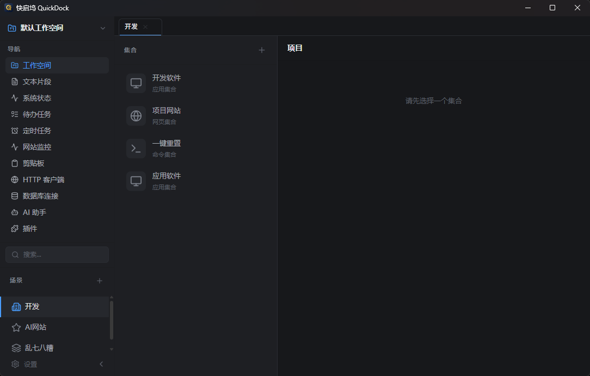

<!-- README 设计说明：英雄区 → 截图 → 功能卡片网格 → 可折叠详解 → 架构 → 技术栈 → 开发指南 → 设计/插件/许可。
     所有长文详解收进 <details>，保证「一眼看懂」且不影响信息完整性。
     修改后请同步官网 website/index.html 的更新日志（见 AGENTS.md 发版纪律）。 -->

<div align="center">

# 快启坞 QuickDock

**面向 Windows 开发者的桌面效率中枢** —— 资源集合 · 快速启动 · 工作空间管理

*Raycast 的快启体验 × VS Code 的开发者质感，加上开箱即用的本地开发环境*


🌐 官网 <https://parieses.github.io/quickdock/>　·　🐛 Issues <https://github.com/parieses/quickdock/issues>　·　🔌 插件市场 <https://github.com/parieses/quickdock-plugins>

</div>

---



> 一张图看不全 —— 它把「资源管理、剪贴板、命令面板、待办、监控、AI、环境管理、插件」全收进一个窗口，下面拆开讲。

---

## ✨ 它解决什么

开发者桌面上永远散落着：项目目录、常用命令、文档链接、待办、监控地址、一堆需要切换版本的运行时……QuickDock 把它们统一收进一个**键盘优先**的窗口里，并额外塞进了截图、窗口排版、本地站点 HTTPS、AI 助手和插件市场。

- **一处收纳**：工作空间 → 场景 → 集合 → 项目 四级资源树，支持拖拽、全文搜索与变量展开
- **键盘驱动**：`Ctrl+Space` 主窗口、`Ctrl+K` 命令面板、`Ctrl+`` 剪贴板、`F1` 截图，全部可改键
- **开箱环境**：28 种运行时（语言 / 服务 / 数据库 / 中间件 / AI）一键安装、版本切换、启停、日志、控制台
- **本地智能**：内置 AI 助手（多模型 SSE 流式）+ DeepSeek Harness 编程入口 + 对 Agent 开放的 MCP 服务
- **免管理员**：单文件应用、用户态安装、免 UAC 就地更新

---

## 🧩 功能全景

<details open>
<summary><b>核心效率</b></summary>

| 能力 | 默认热键 | 一句话 |
|------|---------|--------|
| 工作空间 / 场景 / 集合 / 项目 | — | 四级资源树，6 种项目类型，拖拽排序 + FTS5 全文搜索；主界面按「导航 / 场景 / 集合 / 项目」分栏，场景独立成栏，导航再多也挤不到场景 |
| 命令面板 | `Ctrl+K` | 跨工作空间 / 场景 / 集合 / 项目统一搜索，URL 智能识别存为项目 |
| 剪贴板历史 | `` Ctrl+` `` | 文本 / 图片 / 文件监听，固定、搜索、过期清理，浮动窗口唤出 |
| 快捷笔记 | `Ctrl+Alt+N` | 树形 Markdown 笔记库，自动保存，失焦隐藏 |
| 最近动态 | — | 「设置 → 最近动态」：左栏是使用热度榜（最常打开的项目 / 场景），右栏是操作时间线，知道自己这段时间在忙什么 |
| 崩溃记录 | — | 「设置 → 日志」侧栏列出 JS / Go panic 崩溃现场，带时间与组件名，可逐条查看堆栈或一键清空 |

</details>

<details open>
<summary><b>任务与监控</b></summary>

| 能力 | 说明 |
|------|------|
| 待办 + 🍅 番茄专注 | 列表 / 看板视图、子任务、标签、重复与到期提醒；专注结束系统通知 + 可选 Webhook |
| 定时任务 | 5 种动作 × 4 种调度（一次性 / 间隔 / 每天 / 每周），执行后系统通知 |
| 网站监控 | HTTP 状态码 / 响应时间、SSL 到期预警、关键字 / 正则匹配、响应趋势图，状态翻转多渠道推送 |

</details>

<details open>
<summary><b>AI 与开发</b></summary>

| 能力 | 说明 |
|------|------|
| AI 助手 | OpenAI / DeepSeek / Kimi / 通义 / Ollama / Azure / 自定义兼容；SSE 流式、思考折叠、Markdown 渲染、DPAPI 加密 Key；填好 BaseURL 与 Key 即可一键拉取可选模型列表 |
| AI 图片理解 | 对话里贴图 / 选文件 / 拖拽，AI 直接理解图片内容；缩略图可点击全屏放大；按模型能力配置输入方式 |
| 终端内 AI 助手 | SSH 终端里的 AI 侧栏：问题里提到「屏显」才附带当前屏幕、选中输出右键即问、命令一键填入 / 执行；回答可中途停止；高危命令只给填入，生产环境额外要求二次确认 |
| 剪贴板 AI | 剪贴板条目上「问 AI」：翻译 / 摘要 / 格式化或自由提问，就地弹层给出答案，不跳页 |
| 笔记 AI | 笔记浮窗内嵌面板：总结 / 润色 / 续写 / 翻译，关掉面板就回到原文 |
| DeepSeek Harness | 内嵌 `dsh` 完整 Agent 编程入口，便携 Node 自动装填，原生窗口承载 3080 端口 |
| 内置 MCP 服务 | `http://127.0.0.1:9230/mcp`，三级权限门（只读 / 低危写 / 高危），把本地能力开放给智能体 |
| 环境管理 | 28 种运行时一键装 / 切 / 启停 / 配 / 看日志 / 开控制台，纯用户态不污染 PATH |

</details>

<details open>
<summary><b>工具箱</b></summary>

| 能力 | 默认热键 | 说明 |
|------|---------|--------|
| 截图工具 | `F1` | 原生分层窗口零闪；框选 → 标注 → 复制 / 保存 / 贴图一条链路；窗口 / 元素吸附 |
| 窗口管理 | `Ctrl+Alt+W` | 15 个贴屏热键 + 九宫格排版浮层，不抢 `Win+方向` |
| 本地开发站点 | — | 项目一键绑自定义域名 + 自动 HTTPS（mkcert），自身不监听端口 |
| SSH 远程终端 | `Ctrl+Alt+S` | 独立可缩放窗口管理远程主机：多标签终端 + SFTP 文件管理，指纹信任防中间人；同一分组可多选主机批量执行，逐台回传结果 |
| 终端内 AI 助手 | — | 提到「屏显」才带上当前屏幕（不提就不发，省 token 也不跑偏）；选中输出右键即问；命令一键填入 / 执行，高危命令只给填入，生产环境需二次确认；回答可切流式 / 一次性（默认流式）、也可中途停止 |
| WebDAV 云同步 / 快照备份 | — | 全量 JSON 备份恢复、多版本、任意 WebDAV；一键导出导入 |
| 界面缩放 | — | 主界面与全部独立窗口（剪贴板 / 笔记 / 命令面板 / 窗口管理 / SSH / 插件）统一 1.15x 等比放大，文字、图标、间距一起放大而布局比例不变 |

</details>

<details open>
<summary><b>插件生态</b></summary>

- 开放插件架构，三种运行时：**none（纯前端）/ goja（内嵌 JS 沙箱）/ native（独立子进程）**，基于 JSON-RPC 2.0
- 34 个 Host API / 14 组能力，权限声明式校验（文件系统 scope、网络白名单、剪贴板、进程等），native 安装期做 `go/ast` 静态审计
- 向插件开放宿主 AI 能力：`host.ai.ask` 复用用户已配好的档案（凭据不出后端），带 `streamId` 即流式——三种运行时各有增量通道（native 走 `host.ai.delta` 通知、goja 走 `api.aiStream` 回调、前端插件走 `qdAiAsk`）
- 官方插件经「在线市场」一键安装 / 升级，清单与开发文档统一在 [quickdock-plugins](https://github.com/parieses/quickdock-plugins)

</details>

---

## 🚀 快速开始

### 系统要求

- **操作系统**：Windows 10 1809+ 或 Windows 11
- **运行时**：WebView2 Runtime（Windows 自带）
- **磁盘**：约 50 MB（运行时按需下载）

### 下载安装

1. 从 [Releases](https://github.com/parieses/quickdock/releases) 下载 `quickdock-amd64-installer.exe`
2. 双击安装（**免管理员权限**，默认装到用户目录 `%LOCALAPPDATA%\Programs\快启坞`）
3. 运行 `QuickDock.exe`，任务栏托盘出现图标即启动成功

> **保持默认安装路径**：就地替换更新需要对该目录有写权限。若改到 `C:\Program Files\...`，每次更新都要过 UAC，自动更新会失败（只能手动覆盖）。
> 也可直接下载 `quickdock-amd64.exe` 当便携版：只要放在**当前用户可写**的目录（非 `Program Files`），同样支持就地更新。

### 快捷键速览

| 功能 | 默认快捷键 |
|------|-----------|
| 切换主窗口 | `Ctrl+Space` |
| 命令面板 | `Ctrl+K` |
| 剪贴板历史 | `` Ctrl+` `` |
| 快捷笔记 | `Ctrl+Alt+N` |
| 区域截图 | `F1`（被占用回退 `Ctrl+Shift+A`） |
| 窗口排版浮层 | `Ctrl+Alt+W` |
| SSH 远程终端 | `Ctrl+Alt+S` |

> 所有热键均可在「设置 → 热键 / 窗口管理」页面自定义、运行时动态重注册。

---

## 📚 功能详解

<details>
<summary><b>📦 工作空间与资源管理</b></summary>

- **工作空间（Workspace）** — 顶级容器，隔离不同项目上下文
- **场景（Scene）** — 工作空间下的视图分组，支持标签 / 图标 / 颜色
- **集合（Collection）** — 资源逻辑分组，支持四种打开策略
- **项目（Item）** — 6 种类型：
  - `directory` 目录 · `file` 文件 · `url` 网页 · `command` 终端命令 · `app` 应用 · `quicklink` 带参快捷方式
- 全层级拖拽排序、FTS5 全文搜索；`value` / 命令 / URL 支持 `{date}` `{time}` `{username}` `{clipboard}` 变量即时展开

</details>

<details>
<summary><b>📋 剪贴板历史</b></summary>

自动监听文本 / 图片 / 文件剪贴板；支持固定、搜索、复制粘贴、批量删除；过期自动清理（可配保留天数）；浮动窗口失焦自动隐藏，`` Ctrl+` `` 一键唤出。

监听带自愈：除了系统通知，还会按剪贴板序号兜底巡检，某次通知漏了也能补抓到；捕获卡住或剪贴板被别的程序长期占用会写进日志，不会表现为"复制了却没记上"。全应用「复制」统一走后端 Win32 写入，不受 WebView2 焦点状态影响——不会再有"点了复制有时没反应"。

条目上还有 **「问 AI」**：文本条目直接就地弹层提问，预置翻译 / 摘要 / 格式化和自由追问，回答流式呈现，代码块单独成卡可复制。没有执行动作——剪贴板里的代码是拿去看的，不是拿来跑的。

</details>

<details>
<summary><b>🔍 命令面板</b></summary>

全局搜索工作空间 / 场景 / 集合 / 项目；选中即操作，键盘导航 + 多选批量；FTS5 全文搜索、URL 智能识别存为项目；最近 / 最常使用列表；浮动窗口 `Ctrl+K` 即时唤出。

</details>

<details>
<summary><b>✅ 待办任务（Todos）</b></summary>

- 待办列表 + 看板视图（待办 / 进行中 / 已完成）
- 子任务、标签分类、重复待办（每日 / 每周 / 每月）、到期系统通知
- 🍅 番茄专注：待办页启动倒计时，结束系统通知 + 可选 Webhook 推送

</details>

<details>
<summary><b>⏰ 定时任务（Scheduler）</b></summary>

- 5 种动作：打开软件 / 目录 / 网页 / 命令 / HTTP 请求
- 4 种调度：一次性 / 按间隔 / 每天 / 每周
- 执行后系统通知，支持手动立即执行

</details>

<details>
<summary><b>📡 网站监控（Monitor）</b></summary>

- 定时探测 HTTP 状态码与响应时间（GET / HEAD / POST）
- SSL 证书到期预警（可自定义提前天数）
- 关键字 / 正则内容匹配
- 在线率统计、检测日志、状态翻转通知（桌面 + Webhook：钉钉 / 企微 / 飞书 / Server酱 / PushPlus / Telegram）
- 响应时间趋势图（24h / 7d / 全部）

</details>

<details>
<summary><b>🗒️ 快捷笔记</b></summary>

浮动笔记窗口 `Ctrl+Alt+N` 即时唤出；**树形笔记库**（文件夹 + Markdown 多层级），搜索 / 重命名 / 删除；自动保存（500ms 防抖）；失焦自动隐藏。

浮窗里的 **「问 AI」** 直接开面板（划选则只送选中的那段，否则送整篇），预置总结 / 润色 / 续写 / 翻译，也能自由追问。整个过程不离开浮窗，也**不会把整篇笔记写进 AI 对话历史**。

</details>

<details>
<summary><b>🧠 DeepSeek Harness 集成</b></summary>

内嵌 [DeepSeek Harness](https://github.com/deepseek-ai/dsh) —— 完整 Agent 编程入口（工具 / 文件 / 终端 / 会话）：

- **一键环境装填** — 自动检测 node / npx / dsh；缺失时下载便携 Node v22（npmmirror → nodejs.org 兜底）并安装 `@deepseek-ai/dsh`
- **原生窗口承载** — `node` 拉起 `dsh web --no-open`（CREATE_NO_WINDOW 隐藏控制台），固定官方端口 **3080**；被健康 dsh 占用则复用、残留 node 则清理重绑，仅被无关进程占用才退随机端口
- **后台常驻** — 关窗不停服务，下次点击秒开；真正停止由设置手动或退出触发
- **实时安装日志** — 下载 / 解压 / npm 安装全程逐行推送 `quickdock:dsh:log`
- **环境净化** — 过滤第三方注入的 `NODE_OPTIONS`，避免污染 dsh 进程

</details>

<details>
<summary><b>💬 AI 助手</b></summary>

- **多配置档案** — OpenAI / DeepSeek / Kimi / 通义千问 / Ollama / Azure OpenAI / 自定义兼容接口
- **模型不用手记** — 填好 BaseURL 与 API Key 后点「拉取模型列表」，直接从这个接口取回可用模型供你选（OpenAI / DeepSeek / Kimi / 通义 / Ollama / Azure 通用）；没保存的草稿也能拉
- **5 种对话模式** — 聊天 / 解释代码 / 翻译 / 总结 / 使用教程，可叠加自定义 System Prompt
- **SSE 流式输出** — 本地 HTTP 流式服务（127.0.0.1，随机端口 + 随机 token），逐 token 即时显示
- **思考过程折叠** — `reasoning_content` 以 `<details>` 折叠，默认收起
- **Markdown 渲染** — `marked` + `DOMPurify` 安全渲染
- **参数可配** — Temperature / MaxTokens / TopP / FrequencyPenalty / PresencePenalty
- **会话管理** — 多会话 / 标题自动生成 / 清空 / 删除；**Token 用量统计**
- **API Key 安全存储** — Windows DPAPI 加密，前端不接触密文；支持测试连接
- **一处配置，多处复用** — 同一份档案同时服务对话页、SSH 终端侧栏、剪贴板与笔记的「问 AI」，以及插件调用的 `host.ai.ask`；各入口互不干扰

</details>

<details>
<summary><b>🔌 插件系统</b></summary>

- 三种运行时（none / goja / native）+ JSON-RPC 2.0；统一 Host API（**34 方法 / 14 组**）：日志、存活探测、通知、剪贴板、对话框、按插件隔离 KV（`db.*`）、文件读写（`host.fs.*`，按 `permissions.filesystem` 目录 scope 校验）、网络代发（`http.get/post`，域名白名单）、Shell 打开、进程 list/exec/kill（需 `process` / `processKill` 权限）、窗口显隐、加解密（`host.crypto.*`）、复用宿主 MCP 的 `host.mcp.call`、复用宿主 AI 档案的 `host.ai.ask`（带 `streamId` 即流式）
- 前端桥接：`qdConfirm` / `qdAlert` / `qdPickFile` / `qdPickFolder` / `qdReadFile` / `qdHostCall` / `qdHttp` / `qdAiAsk`（流式问答）/ `qdPrint` / `qdCrypto`
- **权限模型**：manifest `permissions` 声明所需能力，未声明一律拒绝；native 运行时安装期 `go/ast` 静态审计高危能力（如 `os.Remove` / `exec.Command` / `net.Dial`）与声明一致性，不符则告警
- 运行时安装 / 卸载 / 启用 / 禁用 / 热键绑定；官方插件经「在线市场」一键安装升级

</details>

<details>
<summary><b>🛠️ MCP 服务</b></summary>

自暴露 **Model Context Protocol** 服务，供 AI 客户端调用本地能力：

- **地址**：`http://127.0.0.1:9230/mcp`（Streamable HTTP，仅 POST；协议 2025-06-18）
- **工具集三级权限门**（默认只开放只读 + 低危写）：
  - 只读：`app_info` / `env_list` / `env_status` / `env_log` / `env_versions` / `workspace_list` / `item_search` / `recent_items` / `todo_list` / `note_search` / `clipboard_recent` / `port_list` / `log_list` / `log_read` / `crash_list` / `crash_read` / `plugin_list`
  - 低危写：`env_start` / `env_stop` / `env_restart` / `item_open` / `todo_create` / `todo_done` / `clipboard_copy` / `note_create` / `note_update` / `note_quick` / `plugin_execute`
  - 高危（环境管理页开启）：`process_kill` / `system_command`
  - 插件经 `host.mcp.call` 复用全部工具（沿用 MCP 等级门）
- **生命周期**：随主进程，退出即失效；门面装配在 `services/mcp`，工具经各领域门面转发到宿主

</details>

<details>
<summary><b>🔧 环境管理（28 种运行时）</b></summary>

多运行时版本管理，一键安装 / 切换 / 启停，多版本共存于用户目录，不污染系统 PATH、不写注册表、不申请管理员权限。

| 运行时 | 分组 | 类型 | 平台 |
|--------|------|------|------|
| Node.js / Go / PHP / Python / Bun / Erlang / JDK | 语言 | 命令行 / 服务型 | Windows |
| Nginx / Caddy / Apache / Traefik / FTP / WebDAV(内置 9080) | 网络服务 | 服务型 | Windows |
| Redis / Memcached / MinIO / RabbitMQ | 中间件 | 服务型 | Windows |
| Git / Composer / FFmpeg / Mailpit / frpc / GitHub CLI / mkcert | 开发工具 | 命令行 / 服务型 | Windows |
| Ollama / MCP 服务(内置 9230) | AI 服务 | 服务型 | Windows |
| MariaDB / MySQL / PostgreSQL / MongoDB | 数据库 | 服务型 | Windows |

- **核心设计**：便携优先（`%APPDATA%\QuickDock\runtime\<name>\<version>`）、多版本共存、下载源可切换（`{version}` `{v}` `{os}` `{arch}` `{ext}` 占位符）、版本列表智能筛选 + 1h 内存缓存、代理容错与多源回退、后台异步进度推送
- **服务管理能力**：一键启停 / 重启、配置编辑（Nginx / Apache / Caddy 启动前 `*-t` 校验）、实时日志（尾部 8KB）、Web 控制台一键打开、端口全景、本地开发站点（自定义域名 + 自动 HTTPS，自身不监听端口）
- **Ollama 本地大模型**：单版本语义（程序目录 `runtime/ollama/`）、原地更新（只提示不自动）、模型库共享 `~/.ollama/models`、卸载只删程序不碰模型
- **文件结构**：门面层 `services/env/`（31 方法） + 引擎层 `internal/env/`（注册表 / 下载 / 解压 / 服务生命周期 / 项目级版本探测，跨平台 `_windows` `_darwin` `_unix` 分文件）

</details>

<details>
<summary><b>📷 截图工具</b></summary>

Snipaste 形态，`F1` 唤起全屏覆盖层，**框选 → 标注 → 复制 / 保存 / 贴图**一条链路，全程不弹第二窗口。

- **原生覆盖层零闪** — 全屏遮罩是自建 Win32 分层窗口，`UpdateLayeredWindow(ULW_ALPHA)` 整帧提交、不走 `WM_PAINT`；显示顺序 `SW_HIDE → SetWindowPos → 画完 → SW_SHOW` 无空窗期
- **框选后原地浮出工具条** — 矩形 / 椭圆 / 箭头 / 直线 / 马赛克 / 文字 + 颜色(9) / 线宽(4) / 字号(6) + 撤销重做 + 复制 / 保存 / 贴图 / 关闭
- **窗口 / 元素吸附** — 实时高亮光标下窗口，单击选中；`Ctrl` 下沉到子控件；已排除自身窗、`WS_EX_TRANSPARENT`、`DWM cloaked`
- **选框可调、标注可再编辑** — 8 控制点 + 平移；图形点选 / 拖动 / `Delete`；文字双击重编辑（另开 owned 顶层窗承载 IME）
- **贴图钉屏** — 原生 GDI 窗口钉桌面最上层，可拖动 / 滚轮缩放（光标锚点）/ 双击关闭，单张内存即位图本身（非 WebView2 进程）
- **快捷键** — `Enter`/`Ctrl+C` 复制，`Ctrl+S` 保存，`Ctrl+Z`/`Ctrl+Shift+Z` 撤销重做，`Ctrl+A` 全选，`R/E/A/L/M/T` 切工具，方向键微调（`Shift`×10），`Delete` 删除，`Esc` 逐层退出

</details>

<details>
<summary><b>🪟 窗口管理</b></summary>

纯热键驱动「单窗口贴屏 + 批量排版浮层」，不占 `Win+方向`：

- **15 个贴屏热键** — 左 / 右 / 上 / 下半屏、四四分之一、居中、最大化、还原、最小化、置顶切换、移上一屏 / 下一屏（`Ctrl+Alt` 前缀，默认全部可改）
- **排版浮层 `Ctrl+Alt+W`** — 点九宫格任意一块即排版：当前窗口进点击格，其余用同屏其他可见窗口按 Z 序填充；9 种模板（左右对半 / 左主右二 / 右主左二 / 上主下二 / 下主上二 / 四象限 / 三列 / 三行 / 九宫格）
- **分屏比例可调** — 左右半屏宽度占比 10%–90%（默认 50%）；多显示器按光标所在屏换算几何

</details>

<details>
<summary><b>🔐 SSH 远程终端</b></summary>

- **默认热键** — `Ctrl+Alt+S` 唤出独立可缩放窗口，切换窗口不中断会话
- **主机管理** — 主机 + 分组（文件夹）树形组织、拖拽排序、环境标签（生产 / 预发 / 测试）、备注；凭据与配置分离存储
- **认证方式** — 密码 / 私钥（ed25519 等）+ 私钥口令；兼容旧设备 `ssh-rsa` / SHA-1（legacy 开关）
- **服务器指纹信任** — 首次连接弹出指纹确认对话框，可对照服务器命令核对；known_hosts 统一管理（查看 / 清除已信任指纹），指纹变更主动告警，防中间人
- **多标签会话** — 同主机连接池复用（多标签只握手一次）；PTY 终端模拟，支持复制 / 粘贴 / 全选 / 清屏；滚动回放与断线重连
- **SFTP 文件管理** — 远程目录浏览、上传 / 下载
- **命令执行** — 非交互一次性 `Exec`（带超时、退出码、输出截断），用于脚本化运维
- **多主机批量执行** — 在分组上点「批量执行…」勾选多台主机：先**预演**（只读，列出每台将要执行的命令与风险等级）再运行，逐台回传输出与退出码，可随时取消；生产环境的一键执行同样要求二次确认，高危命令仍只给「填入」

</details>

<details>
<summary><b>✨ 终端内 AI 助手（SSH × AI）</b></summary>

终端右侧的 AI 侧栏，把「看到的现象」直接变成「可执行的命令」。

- **看得见现场** — 问题里提到**「屏显」**，这一轮就带上终端当前画面（提到就够了，后面不用再补别的内容；不提就不发，省 token 也不把模型带偏）。屏显不一定报错：正常输出、命令结果、正在运行的程序界面都会被如实说明，不会硬当成故障来分析
- **环境感知** — 侧栏头部常驻环境徽章。生产环境除了告知模型，还会额外约束它的输出口径：**默认先给只读探查命令**，任何写入 / 删除 / 重启 / 改配置的命令都必须写明影响范围与回滚方式
- **选中即问** — 在终端里选中一段输出 → 右键「问 AI 这段输出」，选区单独作为上下文送进模型（比整屏屏显权重更高），侧栏自动打开并预填问题，一个回车就能问
- **命令卡片** — 回答里的命令单独成卡，支持**一键填入终端**或**一键执行**，不用再复制粘贴；空状态里的示例问题点一下即填入输入框
- **安全边界** — 只给命令，绝不自动执行，共三层且互为独立：
  - **提示词层**：生产环境要求模型先探查后变更、变更带回滚（约束默认行为，而不是事后匹配词表）
  - **标注层**：`rm -rf` / `dd` / `mkfs` / `iptables -F` / `reboot` / `kubectl delete` / `docker rm` / `DROP TABLE` / `git reset --hard` / `git push -f` 等高危命令**只有「填入」，没有「执行」**，必须由你亲自按回车；中风险命令（`systemctl restart`、`sed -i`、卸载软件包、`crontab -r` 等）保留一键执行，但卡片上先给出风险说明再给按钮。多个规则同时命中时取**最高等级**，不会出现"命中了高危却被判成中等"
  - **确认层**：生产环境上「执行」需点两次（第一次只把按钮切成「再点一次确认」）。规则表是有限收录的——`sed -i` 改错配置、一条没写完的 `DELETE` 都匹配不到任何规则，界面上看起来"很安全"，这一层就是给这类漏网命令兜底的；测试 / 预发保持一步到位
  - 「填入」只写进远端输入缓冲不发回车，你仍能在屏幕上审视这条命令
- **多轮追问** — 侧栏内保留上下文连续追问；提示词按优先级控预算（本次问题 > 屏显 > 历史），历史过长时丢最旧的；更早的轮次会被**自动压成一段摘要**继续带着走，所以问得再多也不会越问越卡
- **问不下去就停** — 「思考中」时发送键变成停止键，模型迟迟不来或你已看清一半，点一下立刻退出等待，不用干等转圈
- **多主机隔离** — 切换会话自动清空上下文，不会把 A 机器的屏显带给 B 机器
- **回答方式可选** — 面板头部一个开关：**流式**（默认，边生成边显示）或**一次性**返回整段。偏好存在本地，SSH / 剪贴板 / 笔记三处共用同一份，不会这个面板关了那个还开着
- **用的是哪个档案** — 标题旁显示当前激活的 AI 档案名（hover 看模型），配了多个 Key 时一眼能看出这一问走的是哪个
- **未配置就带走** — 没配 API Key 时点「问 AI」不会打开一个注定失败的面板，而是直接带你去「设置 → AI」填 Key
- **配置独立** — 复用 AI 档案，但与对话页互不干扰：不落库、不占对话上下文

</details>

<details>
<summary><b>☁️ WebDAV 云同步 / 📸 快照备份 / 🖥️ 系统命令</b></summary>

- **WebDAV 云同步** — 全量 JSON 备份 / 恢复、多版本、任意 WebDAV 服务器；统一「同步后端」分层（`services/sync.go` → `internal/sync` → `internal/webdav`），未来可接入 Git / 对象存储
- **快照备份** — 一键导出全部数据为 JSON，导入恢复，迁移无忧
- **系统命令** — 锁屏 / 关机 / 重启 / 睡眠 / 清空回收站

</details>

<details>
<summary><b>🔄 自动更新（Windows 免安装器就地替换）</b></summary>

启动后拉取**签名更新清单**并验签：

```
https://github.com/parieses/quickdock/releases/latest/download/manifest.json
```

| 阶段 | 行为 |
|------|------|
| 检查 | 拉取 manifest.json，ed25519ph 验签 + sha512 校验；版本更高才提示 |
| 下载 | 下载裸 `quickdock-amd64.exe` 并校验摘要（多源镜像回退） |
| 重启 | 点「重启更新」→ 派生 helper → 主进程退出 |
| 替换 | helper 备份旧 exe → 覆盖新 exe（失败回滚）→ 重新拉起 |

整个过程**不弹 UAC、不跑安装器**，用户数据 / 数据库 / 插件 / 运行时目录全部保留（单文件应用，前端 `go:embed` 进 exe）。

- **macOS**：每 release 产出 `quickdock-darwin-arm64` / `quickdock-darwin-amd64` 两个包；`.app` 须装到 `~/Applications`（普通权限可写）方可就地更新；无 Developer ID 时为 ad-hoc 签名，正式分发需补签名 + 公证
- **发版纪律**：版本号唯一来源是 **git tag**，`main.appVersion` 恒为 `"0.0.0"`，打包时由 Taskfile 的 `APP_VERSION`（`git describe --tags --abbrev=0`）经 ldflags 注入 —— **发版只打 tag，不改任何版本文件**

</details>

---

## 🏗️ 架构

服务门面分层 + 引擎下沉，依赖方向单向无环：

```
┌──────────────────────────────────────────────────────────────────┐
│                         QuickDock (Wails v3)                       │
│                                                                    │
│   ┌────────────────────┐      ┌────────────────────────────────┐  │
│   │  Vue 3 Frontend     │◄────►│  services/  Wails 绑定门面        │  │
│   │  (frontend/dist     │ IPC  │  AppService + 21 领域门面子包    │  │
│   │   go:embed)         │      │  约 250 绑定方法                 │  │
│   └────────────────────┘      └───────────────┬────────────────┘  │
│                                                │ 单向依赖          │
│                                 ┌──────────────▼────────────────┐  │
│                                 │  internal/  引擎层（无绑定）    │  │
│                                 │  db / env / sites / dsh /      │  │
│                                 │  plugin / platform / sync /    │  │
│                                 │  webdav / webdavsrv / mcp /   │  │
│                                 │  screenshot / winmgr / dl /   │  │
│                                 │  logger / sysutil / validators │  │
│                                 └───────────────────────────────┘  │
└──────────────────────────────────────────────────────────────────┘
```

**架构亮点**

- **门面分层**：领域能力下沉为 21 个门面子包，宿主核心留在 AppService（约 62 方法）经全导出字段回指（约 190 方法），依赖单向无环
- **截图覆盖层走原生窗口而非 WebView**：自建 Win32 分层窗口 `UpdateLayeredWindow` 整帧提交，工具条 / 标注 / 图形全手绘进同一张 DIB —— 这是「截图不闪」的唯一解
- **次级窗口延迟创建**：首次热键触发才创建 WebView2，避免白屏；浮窗位置经 kvstore 持久化，重启原位恢复
- **后台服务**：SQLite WAL + 待办(10s) / 定时 / 监控调度器 + 流式 HTTP（AI）+ 插件健康检查 + DSH 隐藏进程 + 内置 MCP(9230)
- **安全**：纯 Go SQLite（零 CGO）、SQL 白名单防注入、API Key DPAPI 加密、单实例锁防并发写库、本地 SSE 流式用随机端口 + 随机 token
- **规模（实测）**：Go 源码 ~7.3 万行（`internal` 5.6w + `services` 1.7w，含 67 测试文件），前端 ~3.9 万行（54 Vue 组件 + 50 TS 模块）

---

## 💻 技术栈

**后端**

| 技术 | 说明 |
|------|------|
| Go 1.25 | 主语言 |
| Wails3 v3.0.0-alpha2.122 | 桌面应用框架 |
| modernc.org/sqlite | 纯 Go SQLite（无 CGO） |
| go-sql-driver/mysql + go-redis/v9 | MySQL / Redis 客户端 |
| golang.org/x/sys | Windows 系统 API |
| dop251/goja | JavaScript 沙箱（插件执行） |
| DPAPI | Windows 数据保护 API（Key 加密） |

**前端**

| 技术 | 说明 |
|------|------|
| Vue 3 + TypeScript | UI 框架 |
| Vite 8（Rolldown） | 构建工具 |
| Pinia 3 | 状态管理 |
| vue-i18n 11 | 国际化（简中 / English） |
| @lucide/vue | 图标库 |
| pinyin-pro | 拼音搜索 |
| marked 18 + DOMPurify | Markdown 安全渲染 |
| @floating-ui/vue 2 | 浮层定位 |
| @wailsio/runtime 3.0.0-alpha.96 | Wails 前端运行时 |

---

## 🔧 开发指南

### 前置条件

- Go 1.25+
- Node.js 22+
- Wails3 CLI（**版本须与 `go.mod` 一致**，当前 `alpha2.122`）

```bash
# 安装 Wails3 CLI（版本必须与 go.mod 的 wails 模块完全一致）
go install github.com/wailsapp/wails/v3/cmd/wails3@v3.0.0-alpha2.122

# 前端依赖
cd frontend && npm install

# 重新生成 bindings（新增/修改 Go 绑定后必须执行）
wails3 generate bindings -ts -i -clean   # 等价于 cd frontend && npm run bindings
```

### 常用命令

| 命令 | 说明 |
|------|------|
| `wails3 dev` | 开发模式（前后端热重载） |
| `wails3 build` | 生产构建（前端构建 + 绑定生成） |
| `task build` / `task run` | 经 Taskfile 构建 / 运行 |
| `task windows:version` | 输出最终注入 `main.appVersion` 的版本号（发版自检） |

> 开发版与正式版共用同一 SQLite 库与单实例锁，同一时刻只能运行一个实例。

### 数据存储

| 路径 | 说明 |
|------|------|
| `~/.quickdock/quickdock.db` | SQLite（WAL + 外键 + 5s busy timeout） |
| `~/.quickdock/images/` | 剪贴板图片 |
| `~/.quickdock/plugins/` | 已安装插件 |
| `%APPDATA%/QuickDock/` | 应用配置 |
| `~/.quickdock/runtime/node` · `~/.quickdock/dsh` | 便携 Node / DSH |
| `~/.quickdock/logs/quickdock-YYYY-MM-DD.log` | 主日志 |
| `~/.quickdock/logs/crash/` | 崩溃现场（`js-*` / `panic-*`，可在「设置 → 日志」查看） |

### 项目结构

```
quickdock/
├── main.go / tray.go / windows.go        # 入口 / 托盘 / 浮动窗口 + 单实例锁
├── services/                             # Wails 门面层（宿主 + 21 领域子包，~250 方法）
│   ├── service.go  api_result.go  types.go lifecycle.go
│   ├── hotkey.go  theme.go  autostart.go  winmgr_service.go
│   ├── app_launcher.go  focus.go  tool.go  clipboard_sys.go
│   ├── screenshot.go  sync.go  palette.go  plugin_hotkey.go
│   ├── schedule.go  schedule_runner.go  reminder.go  webhook_notify.go
│   ├── monitor_checker.go
│   └── ai/ clipboard/ collection/ diag/ dsh/ env/ frecency/ item/
│       mcp/ monitor/ note/ plugin/ port/ scene/ snapshot/
│       system/ todo/ update/ workspace/   # 领域门面子包
├── internal/                             # 引擎层（被门面调用，无 Wails 绑定）
│   ├── db/  env/  sites/  dsh/  plugin/  platform/  sync/  webdav/  webdavsrv/
│   ├── mcp/  screenshot/  winmgr/  dl/  logger/  sysutil/  validators/
├── frontend/src/                         # Vue 3 + TS（组件 + TS 模块）
│   ├── App.vue  main.ts  style.css  pages/  i18n/  stores/  composables/  utils/
│   └── components/  # 三栏主界面 / 面板 / 设置 / 插件 / 环境 / 监控 …
├── plugins/                              # 宿主骨架 + 开发模板（外部插件见独立仓库）
├── build/  docs/  website/  image/  Taskfile.yml
├── DESIGN.md  AGENTS.md  LICENSE
└── main_unix.go  main_windows.go  windows_unix.go  windows_windows.go
```

> 更完整的工程约束（提交纪律、样式 token、目录职责、自检清单）见 [AGENTS.md](./AGENTS.md)。

---

## 🎨 设计哲学

**精准暗色极简主义（Precision Dark Minimalism）**

- 暗色为主（层次化灰阶非纯黑），支持深 / 浅 / 跟随系统；强调色 `#4a9eff` 仅用于功能交互
- 三面板布局：侧边栏(210px) | 集合列表(300px) | 项目列表(flex-1)
- 8px 基准间距、系统字体栈（基字 13px）、150ms 过渡、键盘优先、`box-shadow` 替代 `border` 消除布局偏移
- 完整规范见 [DESIGN.md](./DESIGN.md)

---

## 🔌 插件生态

官方插件统一在独立仓库维护与分发 👉 **[quickdock-plugins](https://github.com/parieses/quickdock-plugins)**（插件列表、功能说明与完整开发文档：目录结构、`plugin.json` 字段、三种运行时快速开始、通信协议、调试与发布）。

主仓库仅保留**宿主实现**（`internal/plugin/` 引擎 + `services/plugin/` 门面）；用户安装的插件落在 `~/.quickdock/plugins/<plugin-id>/`。随仓库挂载的部分外部插件涵盖：HTTP 客户端、数据库连接、OCR、端口检查、JSON / 正则 / 哈希 / 颜色 / JWT / 二维码工具、PDF / 图片工作室、代码对比、Hosts 管理、网络诊断、磁盘分析、重复文件查找、批量重命名、本地文件搜索、图床上传 等。

---

## 📄 许可协议

[MIT License](./LICENSE) © 2025–2026 王亮亮

## 🙏 致谢

- [Wails](https://wails.io/) · [Vue.js](https://vuejs.org/) · [Floating UI](https://floating-ui.com/) · [Lucide](https://lucide.dev/)
- [modernc.org/sqlite](https://modernc.org/sqlite) · [marked](https://marked.js.org/) · [DOMPurify](https://github.com/cure53/DOMPurify)
